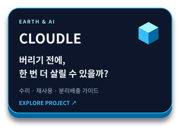
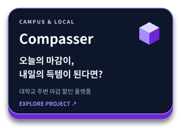
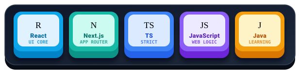

  

 

  
  &nbsp;
  
  &nbsp;
  

 

  
   
   
  <b>👋 안녕하세요, 프론트엔드 개발자 고민균입니다.</b>
   
  Frontend Development · Reusable Structure · Better User Experience

 

## 🧸 About Me

> ### **집요한 책임감으로 문제를 구조적인 개선으로 연결합니다.**

사용자 흐름이 자연스럽게 이어지는 화면을 만들고,  
**팀이 같은 기준으로 개발할 수 있는 구조**를 고민하는 프론트엔드 개발자입니다.

화면에 드러난 문제에서 출발해 상태와 데이터 흐름을 확인하고,  
반복되는 문제는 공통 구조와 개발 기준으로 정리합니다.

 

### 🧩 제가 중요하게 생각하는 것

| Focus | How I Work |
| :--- | :--- |
| 🧩 **Reusable Structure** | 반복되는 UI와 설정을 공통 패키지와 Storybook으로 정리합니다. |
| ⚡ **Performance** | S3 · CloudFront 기반 전달 구조와 로딩 전략을 개선합니다. |
| 🔄 **State & Data Flow** | TanStack Query · Zustand로 서버 데이터와 클라이언트 상태를 구분해 관리합니다. |
| 🤝 **Team Contribution** | 요구사항, 역할, 우선순위와 작업 기준을 정리해 팀의 개발을 돕습니다. |
| 🤖 **AI × Development** | 요구사항 → 계획 → 구현 → 검증 과정에 AI 에이전트를 활용합니다. |

 

## 🧊 3D Core Projects

세 가지 질문에서 시작한, 세 가지 서비스.

<table>
  <tr>
    <td width="33%" align="center">
      
    </td>
    <td width="33%" align="center">
      
    </td>
    <td width="33%" align="center">
      
    </td>
  </tr>
</table>

 

## 🎹 3D Skill Keycaps

  

  React · Next.js · TypeScript · JavaScript · Java (Learning)

<b>🧰 함께 사용하는 도구</b>

- **State & Styling** · TanStack Query · Zustand · Tailwind CSS
- **Architecture & Collaboration** · Storybook · Turborepo · GitHub Actions
- **Delivery** · AWS S3 · CloudFront · ACM

 

## 🌱 Currently Exploring

| | Area | Exploring |
| :---: | :--- | :--- |
| 🧩 | **Frontend Architecture** | Monorepo · Reusable UI · Design System |
| ⚡ | **Performance** | Rendering · Asset Loading · Caching · CDN |
| ☁️ | **Infrastructure** | AWS · CI/CD · Delivery Architecture |
| 🤖 | **AI × Development** | Agent Workflow · Planning · Verification |

 

<b>🔎 개발하면서 자주 던지는 질문</b>

 

- **사용자 경험** — 로딩과 오류 상황에서도 다음 행동을 알 수 있는가?
- **재사용성** — 반복되는 UI와 설정을 공통 구조로 옮길 수 있는가?
- **데이터 흐름** — 화면의 값이 어디에서 왔고, 언제 갱신되는가?
- **협업** — 다른 팀원도 같은 기준으로 이해하고 수정할 수 있는가?
- **검증** — 구현한 결과가 요구사항과 실제 사용 흐름을 충족하는가?

 

## 🧊 3D Contribution · 2024 → Now

  

 

  

### ✨ Keep digging. Keep improving.

작은 문제를 그냥 넘기지 않고, 
더 나은 사용자 경험과 개발 구조를 만들어갑니다.

 
 

3D SVG assets adapted from
<a href="https://github.com/strongsun806/celestial-github-profile">Celestial GitHub Profile</a>

